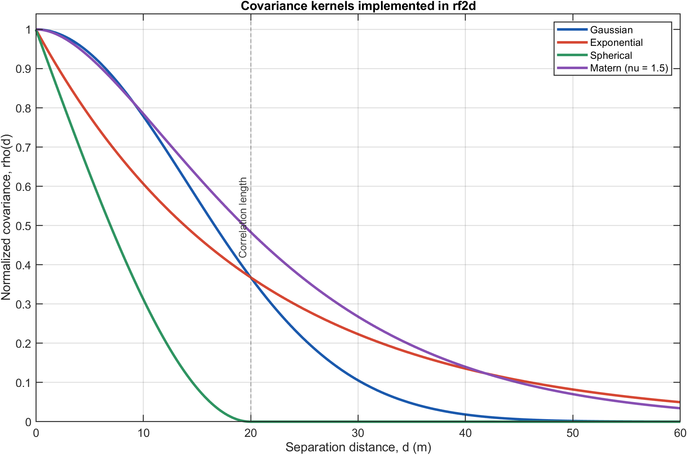
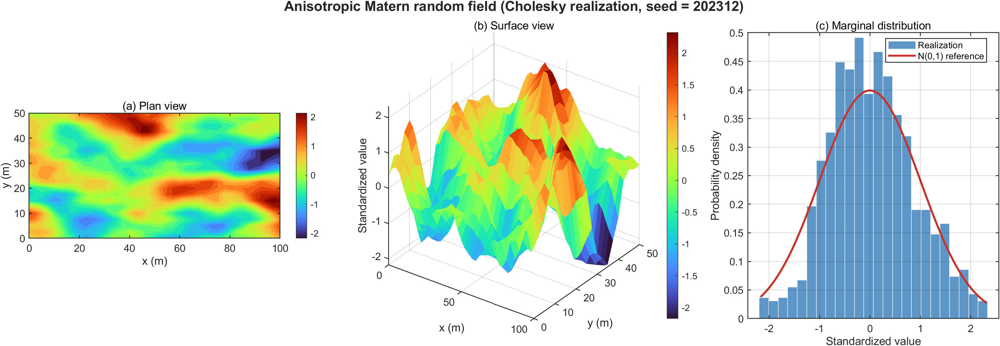
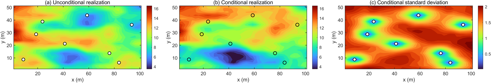

# Cholesky_Midpoint_RF

`Cholesky_Midpoint_RF` is a MATLAB toolkit for simulating two-dimensional Gaussian random fields of spatially variable geotechnical parameters on structured grids. It combines direct Cholesky simulation with scalable solver backends, observation conditioning, visualization, and engineering-data export. A backward-compatible interface is retained for the original homogeneous-site workflow.

## Core capabilities

- Four covariance models: `gaussian`, `exponential`, `spherical`, and `matern`
- Anisotropic correlation lengths in the horizontal and vertical directions
- Direct Cholesky, Karhunen-Loève (KL), circulant-embedding, and Nyström solvers
- Automatic solver selection according to grid size and regularity
- Single or batch realizations, with optional parallel and GPU workflows
- Conditional random fields generated from grid-based observations and observation uncertainty
- Contour, surface, histogram, and variogram-cloud visualization
- CSV, VTK, and MAT export
- Legacy compatibility through `RandomField2DCholMethod.m`, `randex.m`, and `conrandex.m`

## Mathematical formulation

### Structured-grid midpoint coordinates

In the conditional random-field workflow, each cell identified by integer indices `j` and `k` is represented by its midpoint. For cell dimensions `dx` and `dy`, the physical coordinates are

$$x_j = \left(j-\frac{1}{2}\right)\Delta x, \qquad y_k = \left(k-\frac{1}{2}\right)\Delta y.$$

The midpoint convention associates every simulated value with the center of a finite cell rather than a cell corner.

### Anisotropic spatial covariance

Let two grid points be located at

$$\mathbf{s}_i=(x_i,y_i), \qquad \mathbf{s}_j=(x_j,y_j).$$

The implementation introduces direction-dependent correlation lengths through the normalized separation

$$h_{ij}=\sqrt{\left(\frac{x_i-x_j}{\ell_x}\right)^2+\left(\frac{y_i-y_j}{\ell_y}\right)^2}.$$

where `corrLength(1)` and `corrLength(2)` correspond to the positive scales `ell_x` and `ell_y`. The discrete covariance matrix is then assembled as

$$C_{ij}=\sigma^2\rho(h_{ij})+\tau^2\delta_{ij}.$$

where `variance` is the field variance, `nugget` is the diagonal nugget, and the Kronecker delta equals one only when the two indices coincide.

The four normalized kernels implemented by `rf2d.CovarianceModel` are

$$\rho_{\mathrm{Gaussian}}(h)=\exp(-h^2).$$

$$\rho_{\mathrm{Exponential}}(h)=\exp(-h).$$

$$\rho_{\mathrm{Spherical}}(h)=\begin{cases}1-\dfrac{3}{2}h+\dfrac{1}{2}h^3, & 0\leq h\leq 1,\\ 0, & h>1.\end{cases}$$

and

$$\rho_{\mathrm{Mat\acute{e}rn}}(h)=\frac{2^{1-\nu}}{\Gamma(\nu)}\left(\sqrt{2\nu}\,h\right)^\nu K_\nu\!\left(\sqrt{2\nu}\,h\right), \qquad \rho_{\mathrm{Mat\acute{e}rn}}(0)=1.$$

Here, `smoothness` is the positive Matérn parameter `nu`, `Gamma` is the gamma function, and `K_nu` is the modified Bessel function of the second kind. The combination of `ell_x`, `ell_y`, and `nu` controls the directional persistence and local roughness of the field.

### Cholesky random-field simulation

For `n` grid points, the covariance matrix is symmetrized and stabilized by a small diagonal jitter before factorization:

$$\mathbf{C}_{\varepsilon}=\frac{\mathbf{C}+\mathbf{C}^{\mathsf T}}{2}+\varepsilon\mathbf{I}=\mathbf{L}\mathbf{L}^{\mathsf T}.$$

If a trial factorization is not positive definite, the Cholesky solver increases the jitter geometrically until a stable lower-triangular factor is obtained. A standard-normal vector is then transformed into a correlated realization:

$$\mathbf{z}\sim\mathcal{N}(\mathbf{0},\mathbf{I}), \qquad \mathbf{X}=\mu\mathbf{1}+\mathbf{L}\mathbf{z}.$$

Consequently,

$$\mathbb{E}[\mathbf{X}]=\mu\mathbf{1}.$$

and

$$\operatorname{Cov}[\mathbf{X}]=\mathbf{L}\operatorname{Cov}[\mathbf{z}]\mathbf{L}^{\mathsf T}=\mathbf{L}\mathbf{L}^{\mathsf T}=\mathbf{C}_{\varepsilon}\approx\mathbf{C}.$$

For batch simulation, the same factor multiplies a matrix of independent standard-normal samples, which avoids repeating the factorization.

### Lognormal transformation for geotechnical parameters

Positive geotechnical parameters such as cohesion and friction angle are commonly represented by lognormal random fields. Given a target arithmetic mean `m` and coefficient of variation `v`, the corresponding normal-space parameters are

$$s_{\ln}=\sqrt{\ln(1+v^2)}.$$

$$m_{\ln}=\ln(m)-\frac{1}{2}s_{\ln}^2.$$

If `G(s)` is a zero-mean, unit-variance Gaussian random field, the physical parameter field is obtained from

$$P(\mathbf{s})=\exp\!\left[m_{\ln}+s_{\ln}G(\mathbf{s})\right].$$

This transformation gives the requested first two marginal moments:

$$\mathbb{E}[P]=m, \qquad \frac{\sqrt{\operatorname{Var}[P]}}{\mathbb{E}[P]}=v.$$

The legacy adapter uses this mapping to construct spatially varying cohesion and friction-angle fields from two Gaussian realizations.

### Conditioning on site observations

Let `x_u` denote an unconditional realization over all grid cells, `y` the vector of measured values, and `H` the operator that selects simulated values at the observation cells. Define `C_go` as the grid-to-observation covariance, `C_oo` as the observation-to-observation covariance, and `R` as the diagonal observation-error covariance:

$$\mathbf{R}=\operatorname{diag}\left(\sigma_{\mathrm{obs},1}^{2},\ldots,\sigma_{\mathrm{obs},m}^{2}\right).$$

The kriging gain used by `rf2d.ConditionalRandomField` is

$$\mathbf{K}=\mathbf{C}_{go}\left(\mathbf{C}_{oo}+\mathbf{R}\right)^{-1}.$$

Each unconditional realization is corrected by its observation-space innovation:

$$\mathbf{x}_{c}=\mathbf{x}_{u}+\mathbf{K}\left(\mathbf{y}-\mathbf{H}\mathbf{x}_{u}\right).$$

The correction is strongest near reliable observations and decays spatially according to the selected covariance model. Nonzero observation variance prevents exact interpolation and represents measurement uncertainty.

### Alternative solver backends

- **KL solver:** retains the leading covariance eigenpairs and samples from the reduced expansion

  $$\mathbf{X}\approx\mu\mathbf{1}+\mathbf{V}_r\mathbf{\Lambda}_r^{1/2}\mathbf{z}_r.$$

- **Circulant embedding:** embeds the stationary covariance on a larger regular grid, obtains its nonnegative spectrum using a two-dimensional FFT, and samples realizations through an inverse FFT.
- **Nyström approximation:** selects landmark points and constructs a low-rank covariance approximation

  $$\mathbf{C}\approx\mathbf{C}_{nm}\mathbf{C}_{mm}^{-1}\mathbf{C}_{mn}=\mathbf{B}\mathbf{B}^{\mathsf T}.$$

These backends reduce the memory or computational cost of direct dense factorization for larger problems.

## Scientific visualization

### Covariance-kernel comparison



The kernels produce distinctly different rates of spatial decorrelation even when the same nominal correlation length is used. The spherical model has compact support, whereas the exponential and Matérn models retain longer tails.

### Anisotropic random-field realization



This standardized Matérn field uses correlation lengths of 20 m and 8 m. The plan and surface views expose the directional spatial structure, while the histogram provides a marginal comparison with the standard-normal density.

### Observation-conditioned field



The circles mark the eight synthetic observation locations. Conditioning modifies the same unconditional realization toward the observed values and reduces the ensemble standard deviation in their neighborhoods.

All three figures are reproducible with fixed random seeds:

```matlab
run("demo/generate_readme_figures.m")
```

The script writes the PNG assets to `docs/images/readme/`.

## Requirements

- MATLAB R2020b or newer
- Statistics and Machine Learning Toolbox
- Parallel Computing Toolbox (optional, for `parfor`, `spmd`, and GPU workflows)

## Setup and quick start

Clone the repository, start MATLAB in the repository root, and add the project to the MATLAB path:

```matlab
addpath(genpath(pwd))
```

Generate and visualize a two-dimensional Matérn field:

```matlab
x = linspace(0, 100, 128);
y = linspace(0, 40, 64);
params = struct( ...
    "variance", 2.0, ...
    "corrLength", [20 8], ...
    "smoothness", 1.2, ...
    "nugget", 1e-8);

g = rf2d.createGenerator( ...
    x, y, "matern", params, ...
    "Solver", "auto", ...
    "Seed", 1234);

field = g.realize();
figure;
g.contourPlot(field, 20);
```

## API overview

The principal factory call is

```matlab
g = rf2d.createGenerator(x, y, covarianceModel, covarianceParameters, Name=Value);
```

Supported name-value options are:

- `Solver`: `"auto"`, `"cholesky"`, `"kl"`, `"circulant"`, or `"approximate"`
- `Seed`: random seed
- `UseGPU`: logical flag for solver sampling
- `Mean`: scalar Gaussian-field mean
- `MaxDirectPoints`: automatic-routing threshold for dense direct solvers
- `MaxRank`: rank used by the Nyström approximation
- `KLModes`: number of retained KL modes
- `Jitter`: numerical stabilization term

Common generator methods include:

- `realize()` or `realize("UseGPU", ..., "UseParallel", ...)`
- `generateBatch(nFields, useGPU, useParallel)`
- `reseed(seed)`
- `contourPlot`, `surfacePlot`, `histogramPlot`, and `variogramCloud`
- `exportCSV`, `exportVTK`, and `exportMAT`

### Conditional random-field API

- `rf2d.runConditionalRandomField(config)` runs the file-based pipeline.
- `rf2d.ConditionalRandomField.fromTables(gridTable, observationTable, config)` runs an in-memory pipeline.
- `randex(config)` and `conrandex(config)` provide compatibility entry points.

The minimum configuration groups are:

- `grid.dx`, `grid.dy`
- `covModel.type`, `covModel.rangeX`, `covModel.rangeY`, `covModel.nugget`
- `prior.mean`, `prior.std`
- `sim.nRealizations`, `sim.randomSeed`, `sim.jitter`
- `io.gridTablePath`, `io.observationPath`, `io.unconditionalPath`, `io.conditionalPath`
- `logging.enabled`, `logging.level`

The grid table must contain `id`, `j`, and `k`; the observation table must contain `j`, `k`, `obsValue`, and `obsVar`.

## Solver selection behavior

With `Solver="auto"`, the factory uses:

- Cholesky when the number of grid points does not exceed `MaxDirectPoints`;
- circulant embedding for larger regular grids;
- the approximate Nyström solver for larger nonregular cases.

Explicit requests for Cholesky or KL above the direct-point threshold are routed to Nyström. If solver preparation fails for numerical reasons, the generator also falls back to the approximate solver.

## Repository structure

- `+rf2d/`: covariance, generation, conditional-field, validation, and compatibility code
- `+rf2d/+solvers/`: Cholesky, KL, circulant-embedding, and Nyström solvers
- `+rf2d/+viz/` and `+rf2d/+io/`: plotting and export helpers
- `demo/`: benchmark, CRF, Live Script, and README-figure scripts
- `tests/`: MATLAB unit and regression tests
- `+docs/generateDocs.m`: HTML-documentation publisher
- `+toolbox/buildToolbox.m`: MATLAB toolbox packager
- `RandomField2DCholMethod.m`: historical API wrapper

## Legacy entry point

The historical function remains available:

```matlab
[RFC, RFPHI, c, phi] = RandomField2DCholMethod("Coord1.xlsx", 1, 0);
```

It delegates to `rf2d.LegacyAdapter` and preserves the original output shapes.

## Demos and documentation

Run the solver benchmark and plotting demo:

```matlab
run("demo/demo_benchmark_rf2d.m")
```

Run the CRF example with the project sample tables:

```matlab
run("demo/demo_crf_rf2d.m")
```

Generate HTML documentation or an installable MATLAB toolbox with:

```matlab
docs.generateDocs
toolbox.buildToolbox
```

Generated HTML is written to `docs/html/`, and the toolbox package is written to `dist/`.

## Testing

Run the complete test suite:

```matlab
results = runtests("tests", "IncludeSubfolders", true);
table(results)
```

Run the suite with an HTML coverage report:

```matlab
import matlab.unittest.TestRunner
import matlab.unittest.plugins.CodeCoveragePlugin
import matlab.unittest.plugins.codecoverage.CoverageReport

suite = testsuite("tests", "IncludeSubfolders", true);
runner = TestRunner.withTextOutput;
runner.addPlugin(CodeCoveragePlugin.forFolder( ...
    pwd, ...
    "Producing", CoverageReport("tests/coverage")));
results = runner.run(suite);
```

## Reference

Zhang, Z.Y. (2023). *Homogeneous Site Geotechnical Parameter Random Field Simulation System V1.0*. Computer Software Copyright Registration No. 2023SR1776592, China. Registered December 2023.
